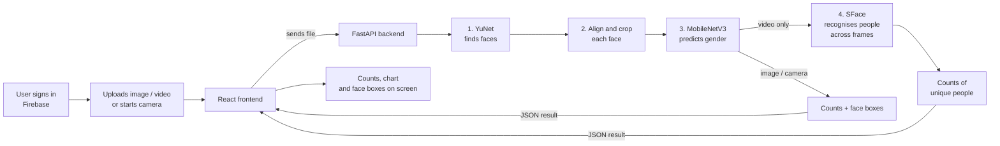

# GENDER-STATS-COUNTER

A web app that counts how many men and women appear in an **image**, a **video** or a **live camera** feed.

Upload a photo or video, or turn on your camera. The app finds every face, predicts the gender of each one, and shows the totals with a chart and a box drawn around each face. In videos, each person is counted only once, even if they leave the frame and come back.

## Features

- **Three input modes:** image upload, video upload and live camera
- **Face boxes** drawn on the image with the predicted gender and confidence
- **Statistics:** male, female and total counts with a distribution chart
- **Download** the analysed image with the boxes and counts drawn on it
- **Unique counting in video:** the same person is never counted twice
- **User accounts:** sign in with Google or email and password (Firebase) before analysing

## Tech Stack

| Part | Technologies |
|---|---|
| Frontend | React, TypeScript, Vite, Tailwind CSS, Firebase Authentication |
| Backend | Python, FastAPI, OpenCV, NumPy, Pydantic |
| Model training | PyTorch, torchvision, Kaggle (Tesla T4 GPU) |
| Model runtime | ONNX models run with OpenCV (no PyTorch needed on the server) |
| Hosting | FastAPI Cloud (backend), Vercel (frontend) |

## Project Flow



### Behind the scenes (backend)

1. **Receive the file:** the backend checks the file type and size, and rejects anything unsupported.
2. **Find faces:** the YuNet model finds every face, plus 5 landmarks on each one (eyes, nose, mouth corners).
3. **Align and crop:** each face is rotated so the eyes are level, then cropped with a small margin. This is exactly how the training images were prepared, so the model sees the same kind of input it learned from.
4. **Predict gender:** the MobileNetV3 model classifies each face. The face and its mirror image are both checked and the two results are averaged, which makes predictions more stable.
5. **Count people (videos only):** the SFace model gives each face a "fingerprint", which is used to tell whether a face belongs to someone already counted.
6. **Send the result:** the backend returns the counts (and face boxes for images) as JSON.

### What happens in each mode

The user must **sign in first** (Google or email). If they try to upload a file or start the camera while signed out, a sign-in window opens.

**Image mode**
1. The user uploads a photo and clicks **Analyze**.
2. The photo is sent to `/detect/image`.
3. The screen shows a box on every face (blue for male, pink for female) with its confidence, plus the counts and a chart.
4. The user can download the photo with the boxes and counts drawn on it.

**Video mode**
1. The user uploads a video and clicks **Analyze**.
2. The video is sent to `/detect/video`. The backend checks 3 frames per second, not every frame, which keeps it fast.
3. Faces in each checked frame go through steps 2–5 above, and the tracker builds a list of unique people.
4. People seen in only one checked frame are ignored, to avoid counting false detections.
5. The screen shows the number of unique men and women, how many frames were checked, and the video length.
6. If the user cancels or leaves the page, the backend stops processing the video straight away.

**Live camera mode**
1. The user clicks **Start camera**, and the browser asks for permission to use it.
2. The app takes a snapshot of the camera image and sends it to `/detect/image`.
3. The face boxes and counts update on screen.
4. 0.3 seconds after each result, the next snapshot is sent, so the counts follow the people in front of the camera in real time.
5. Clicking **Stop camera** ends the loop and turns the camera off. Camera snapshots are never stored.

## Models Used

The app uses three AI models. All three are stored in ONNX format and run with OpenCV.

| Model | Job | Source |
|---|---|---|
| **YuNet** | Finds faces and their landmarks in an image | Pre-trained, from [OpenCV Zoo](https://github.com/opencv/opencv_zoo/tree/main/models/face_detection_yunet) |
| **MobileNetV3-Large** | Predicts whether a face is male or female | **Trained for this project** (see below) |
| **SFace** | Creates a 128-number fingerprint of a face to recognise the same person across video frames | Pre-trained, from [OpenCV Zoo](https://github.com/opencv/opencv_zoo/tree/main/models/face_recognition_sface) |

### YuNet: face detection

A small, fast face detector. Large images are scaled down to 1280 px only for detection, which keeps it fast. Faces smaller than 20 px are skipped because they are too small to classify reliably.

### MobileNetV3: gender classification

MobileNetV3 is a lightweight image classification network designed to run quickly on ordinary CPUs. Its last layer was replaced with a 2-class output (female, male). It was trained in three stages:

| Stage | What was done | Data | Result |
|---|---|---|---|
| 1. First experiment | Trained MobileNetV2 to test the idea | 7,000 face images | 94.1% test accuracy |
| 2. Base model | Trained MobileNetV3-Large, starting from ImageNet weights: first only the classifier layers, then the deeper layers too with a lower learning rate | 58,000 celebrity face images | 96.7% validation accuracy |
| 3. Fairness fine-tuning | Fine-tuned the base model on real-world faces | [FairFace](https://github.com/joojs/fairface): 86,744 photos, balanced across 7 ethnic groups | 91.3% on FairFace (up from 71.3%) |

**Why stage 3 was needed:** the base model scored well on celebrity photos, but on real-world photos it recognised only **48% of women**. Celebrity photos are well-lit, posed and mostly of a few ethnic groups, so the model did not generalise.

**How the fine-tuning was done:**
- Every training face was detected and cropped with the same YuNet and alignment steps the backend uses.
- Training images were randomly made smaller, blurrier or more compressed, to look like faces in real group photos.
- Each batch was balanced across ethnicity and gender, so no group was under-represented.
- All layers were trained for 6 epochs (AdamW optimiser, warm-up then cosine learning rate, label smoothing, mixed precision).
- The decision threshold (0.48) was chosen on a separate hold-out set, so men and women are recognised equally well.
- The final model was exported from PyTorch to ONNX and checked to give the same results in OpenCV.

**Accuracy on the FairFace validation set (10,746 faces):**

| Ethnic group | Before fine-tuning | After fine-tuning |
|---|---|---|
| East Asian | 72.1% | 92.7% |
| Indian | 67.3% | 91.3% |
| Black | 63.9% | 84.8% |
| White | 74.1% | 91.9% |
| Middle Eastern | 80.6% | 94.3% |
| Latino / Hispanic | 72.3% | 92.8% |
| Southeast Asian | 69.5% | 92.1% |
| **All (women / men)** | **71.3%** (48.4% / 91.9%) | **91.3%** (91.1% / 91.5%) |

### SFace: counting each person once in a video

Each face gets a fingerprint. A face is matched to someone already counted when either:
- **they are still in view:** seen in the last 2 seconds, near their last position, with a similar fingerprint, or
- **they came back:** their fingerprint is very similar (similarity of 0.55 or more), at any time and anywhere in the frame.

Otherwise the face is counted as a new person. Each person's final gender is a vote across every frame they appear in, weighted by confidence. Fingerprints are kept in memory only while the video is being analysed and are never saved.

## Project Structure

```
GENDER-STATS-COUNTER/
├── Gendercount_backend/
│   ├── app/
│   │   ├── main.py        # API endpoints
│   │   ├── pipeline.py    # Detect → align → classify flow for images and videos
│   │   ├── models.py      # YuNet, MobileNetV3 and SFace model wrappers
│   │   ├── tracker.py     # Counts each person once in a video
│   │   ├── schemas.py     # API response formats
│   │   └── config.py      # Settings (can be changed in a .env file)
│   ├── models/            # The three ONNX model files + model settings (.json)
│   ├── requirements.txt   # Python packages
│   └── .python-version    # Python version used by FastAPI Cloud
├── Gendercount_frontend/
│   ├── src/
│   │   ├── components/    # Upload, camera, results and sign-in screens
│   │   ├── services/      # Calls to the backend API
│   │   └── lib/           # Firebase setup, image annotation, helpers
│   └── vercel.json        # Vercel settings (security and cache headers)
└── MODEL_DETAILS/
    ├── notebooks/         # Training and testing notebooks (Kaggle)
    └── models/            # PyTorch weights from each training stage
```

## Getting Started

You need **Python 3.11+** and **Node.js 18+**. The commands below are for Windows PowerShell.

### 1. Start the backend

```powershell
cd Gendercount_backend
.\setup.ps1          # first time only: creates a virtual environment and installs packages
.\start_server.ps1
```

The API runs at http://localhost:8000. Interactive API docs are at http://localhost:8000/docs.

### 2. Start the frontend

Open a second terminal:

```powershell
cd Gendercount_frontend
copy .env.example .env   # first time only: then fill in your Firebase values
npm install              # first time only
npm run dev
```

Open http://localhost:8080 in your browser.

## Deployment

The backend runs on **FastAPI Cloud** and the frontend on **Vercel**. Both deploy straight from this GitHub repository and redeploy automatically on every push to `main`. Deploy the backend first, because the frontend needs its URL.

### 1. Backend on FastAPI Cloud

1. Sign up at [fastapicloud.com](https://fastapicloud.com) (the free **Hobby** plan is enough).
2. In the dashboard, create a new app, choose **GitHub Repo**, and select this repository.
3. Set **Root Directory** to `Gendercount_backend`, then click **Create App**.

FastAPI Cloud installs `requirements.txt` with the Python version in `.python-version`, then finds and starts the app in `app/main.py` on its own. When the deployment is ready, open `https://<app-name>.fastapicloud.dev/health`. It should return `{"status":"ok"}`.

### 2. Frontend on Vercel

1. Import the GitHub repository at [vercel.com/new](https://vercel.com/new) and set **Root Directory** to `Gendercount_frontend`. Vercel detects Vite automatically.
2. Under **Environment Variables**, add `VITE_API_URL` (your FastAPI Cloud URL from step 1, without a trailing `/`) and the four `VITE_FIREBASE_*` values from `.env.example`.
3. Click **Deploy**.

### 3. Connect them

1. **Allow the frontend to call the backend:** in the FastAPI Cloud dashboard, open your app → **Environment Variables**, add `CORS_ORIGINS` with your Vercel URL (for example `https://gender-stats-counter.vercel.app`), and click **Save and Redeploy**.
2. **Allow sign-in on the new domain:** in the Firebase console, open **Authentication → Settings → Authorized domains** and add your Vercel domain.

On the free plan, the backend sleeps when nobody is using it and wakes up in a few seconds on the next request. It runs on a small share of a CPU, so analysis is slower than on a local machine.

## API

| Method | Endpoint | Input | Output |
|---|---|---|---|
| GET | `/health` | none | Server status |
| POST | `/detect/image` | Image file (JPG, PNG, WEBP, max 10 MB) | Counts and a box for every face |
| POST | `/detect/video` | Video file (MP4, WEBM, MOV, AVI, max 200 MB) | Counts of unique people, frames analysed, video length |

Example response from `/detect/image`:

```json
{
  "male": 1,
  "female": 1,
  "total": 2,
  "faces": [
    { "box": { "x": 0.41, "y": 0.18, "width": 0.12, "height": 0.16 }, "gender": "female", "confidence": 0.97 },
    { "box": { "x": 0.62, "y": 0.20, "width": 0.11, "height": 0.15 }, "gender": "male", "confidence": 0.93 }
  ]
}
```

Box positions are fractions (0 to 1) of the image size, so the frontend can draw them at any screen size.

## Limitations

- Accuracy drops for side profiles, masks, heavy blur and very small faces.
- Accuracy is lowest on Black faces (84.8%), which is the main area to improve.
- In videos, a person whose face is never clearly visible cannot be counted, and someone returning at a very different angle may occasionally be counted twice.
- The app is meant for overall statistics only. It does not identify people or determine anyone's gender identity.
